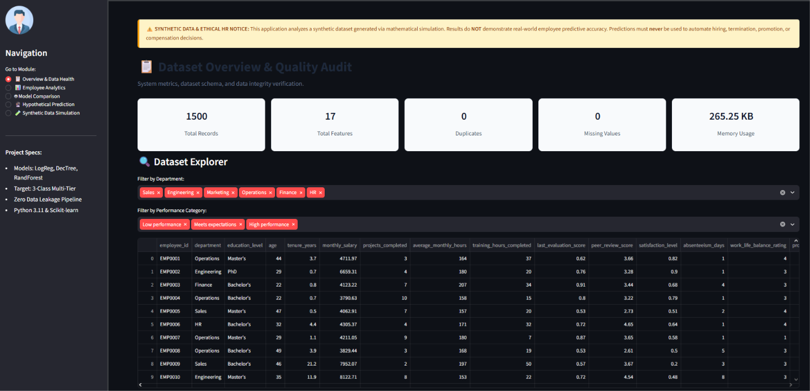
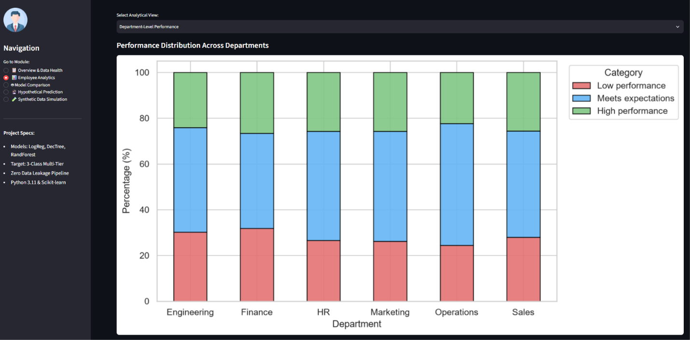
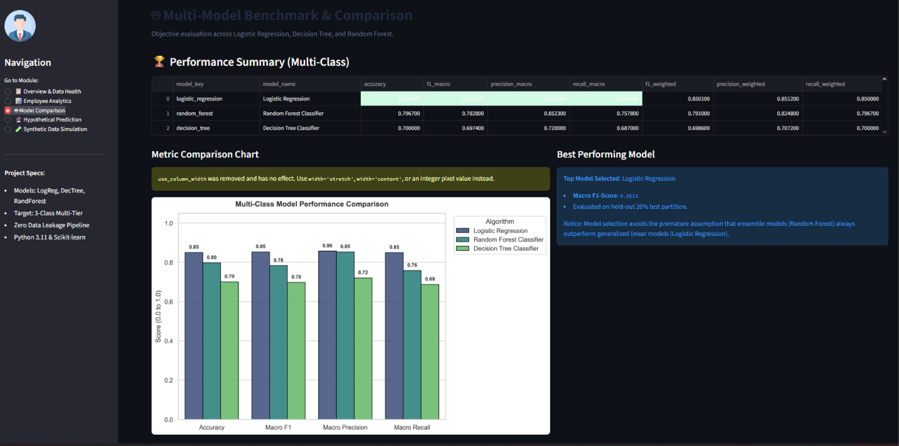
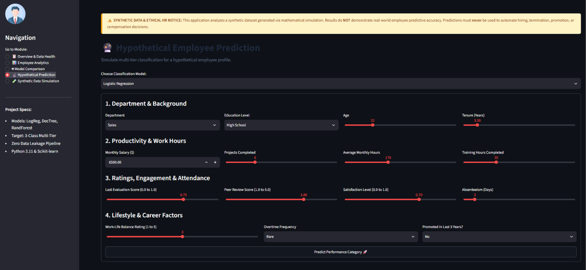
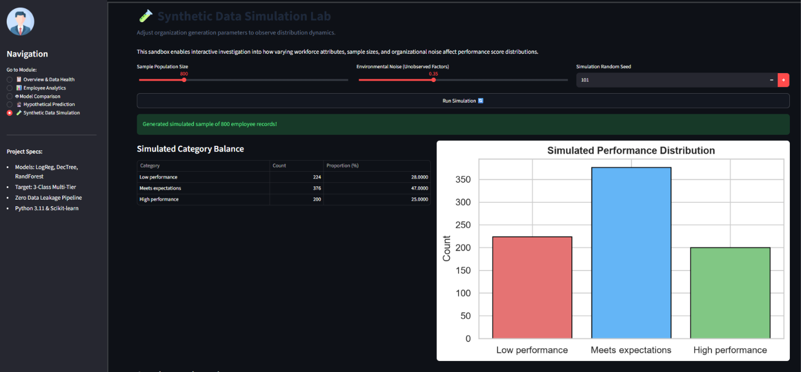

# 💼 Employee Performance Predictor using Data Analytics

[](https://www.python.org/)
[](https://scikit-learn.org/)
[](https://streamlit.io/)
[](#license)
[](#testing)

An end-to-end, reproducible Data Analytics and Machine Learning application that analyzes synthetic human resources data, benchmarks multi-class classification models, and provides an interactive Streamlit dashboard for workforce analytics and hypothetical employee inference.

---

## ⚠️ Responsible AI & Ethical HR Notice

> **IMPORTANT**:
> * **Synthetic Data**: All employee records, demographic profiles, and performance labels are generated using mathematical simulations. They do **not** reflect real company personnel or real-world predictive validity.
> * **Non-Automated Decisions**: Model predictions must **never** be used to automatically make real-world hiring, promotion, compensation, disciplinary, or termination decisions.

---

## 📌 Project Highlights

* **Multi-Class Target (3 Tiers)**:
  * `Low performance` (bottom ~28%)
  * `Meets expectations` (middle ~47%)
  * `High performance` (top ~25%)
* **Three Approved Classification Models**:
  * Logistic Regression (Multinomial)
  * Decision Tree Classifier
  * Random Forest Classifier
* **Empirical Comparison**: Models are benchmarked objectively using multi-class metrics (Accuracy, Macro F1, Macro Recall, Macro Precision) without assuming Random Forest is always superior.
* **Leak-Free Scikit-Learn Pipelines**: Preprocessing transformations (`StandardScaler`, `OneHotEncoder`, `SimpleImputer`) are fitted strictly on the training partition (`X_train`) to guarantee zero data leakage.
* **Interactive Streamlit Dashboard**: 5 feature-rich analytical views for data health, EDA, model evaluation, hypothetical inference, and synthetic data simulations.
* **Automated Unit Testing**: 11 `pytest` test suites covering data generation, pipeline isolation, and inference validation.

---

## 🗂️ Project Directory Structure

```text
Employee-Performance-Predictor/
│
├── data/
│   ├── raw/
│   │   └── employee_data_raw.csv           # Generated synthetic HR dataset (1,500 records)
│   └── processed/
│       ├── train.csv                       # Stratified training split (80%)
│       └── test.csv                        # Stratified test split (20%)
│
├── models/
│   ├── logistic_regression_pipeline.joblib # Serialized pipeline (preprocessor + model)
│   ├── decision_tree_pipeline.joblib       # Serialized decision tree pipeline
│   ├── random_forest_pipeline.joblib       # Serialized random forest pipeline
│   └── model_metadata.json                 # Evaluation metrics, best model key, timestamp
│
├── notebooks/
│   └── 01_exploratory_data_analysis.ipynb  # Interactive EDA walkthrough notebook
│
├── outputs/
│   ├── metrics_summary.csv                 # Tabular model comparison metrics
│   └── figures/
│       ├── target_distribution.png         # Target variable class balance chart
│       ├── correlation_heatmap.png         # Pearson correlation heatmap
│       ├── department_performance.png      # Department performance composition
│       ├── feature_distributions.png       # Boxplots across performance categories
│       ├── confusion_matrices.png          # Side-by-side model confusion matrices
│       └── model_comparison_bar.png        # Bar chart comparing benchmark metrics
│
├── Screenshots/
│   ├── 01_Overview.png                     # Dashboard overview and data health
│   ├── 02_EDA.png                          # Employee analytics
│   ├── 03_mODEL.png                        # Model comparison
│   ├── 04_Prediction.png                   # Hypothetical employee prediction
│   └── 05_Data_Simulation.png               # Synthetic data simulation
│
├── src/
│   ├── __init__.py                         # Package marker
│   ├── config.py                           # Central configuration, filepaths, and constants
│   ├── data_generator.py                   # Realistic synthetic HR data generator
│   ├── preprocessor.py                     # Scikit-learn ColumnTransformer & Pipeline builder
│   ├── eda.py                              # Profiling, data quality checks, figure generation
│   ├── train.py                            # Pipeline training & artifact serialization
│   ├── evaluate.py                         # Multi-class evaluation & model comparison
│   └── predict.py                          # Input validation & hypothetical prediction
│
├── tests/
│   ├── __init__.py
│   ├── test_data_generator.py              # Schema, class validity, and reproducibility tests
│   ├── test_pipeline.py                    # Preprocessor isolation and unseen category tests
│   └── test_models.py                      # Training, metric calculation, and inference tests
│
├── app.py                                  # Interactive 5-view Streamlit web application
├── main.py                                 # End-to-end command-line pipeline runner
├── requirements.txt                        # Pinned dependencies
└── README.md                               # Comprehensive project documentation
```

---

## ⚙️ Installation & Setup Guide

### 1. Prerequisites
Ensure you have **Python 3.10** or higher installed:
```bash
python --version   # Windows
python3 --version  # macOS / Linux
```

---

### 2. Virtual Environment Setup

#### On Windows (Command Prompt / PowerShell):
```cmd
# Navigate to the project root
cd "path\to\Employee Performance Predictor"

# Create a virtual environment named .venv
python -m venv .venv

# Activate the virtual environment
# In PowerShell:
.venv\Scripts\Activate.ps1
# OR in Command Prompt:
.venv\Scripts\activate.bat
```

#### On macOS / Linux:
```bash
# Navigate to the project root
cd /path/to/Employee\ Performance\ Predictor

# Create a virtual environment named .venv
python3 -m venv .venv

# Activate the virtual environment
source .venv/bin/activate
```

---

### 3. Install Dependencies
```bash
pip install --upgrade pip
pip install -r requirements.txt
```

---

## 🚀 How to Run the Application

### Option A: Execute the Full Pipeline via CLI
Runs data generation, exploratory profiling, model training, metric evaluation, and generates high-resolution figures:
```bash
python main.py
```

### Option B: Launch the Interactive Streamlit Dashboard
```bash
streamlit run app.py
```
*The web dashboard will automatically open in your default browser at `http://localhost:8501`.*

### Option C: Run the Automated Pytest Suite
```bash
pytest -v
```

---

## 📊 Streamlit Dashboard Modules

1. **📋 Overview & Data Health**: Real-time KPI cards (records, memory footprint, null counts), dataset explorer with multi-department filters, and label distribution stats.
2. **📊 Employee Analytics**: Deep dive charts analyzing department breakdown, Pearson correlation heatmaps, satisfaction levels, and key performance drivers.
3. **🤖 Model Comparison**: Objective benchmark table, macro-averaged F1 and accuracy comparison charts, confusion matrices, and per-class classification reports.
4. **🔮 Hypothetical Employee Prediction**: Interactive profile simulator with real-time range validation, category badge outputs, class confidence progress bars, and ethical guidance.
5. **🧪 Synthetic Data Simulation**: Sandbox allowing users to adjust population sample size, organizational volatility/noise, and random seeds to test data stability.

---

## 🖼️ Dashboard Screenshots

### Overview & Data Health


### Employee Analytics


### Model Comparison


### Hypothetical Employee Prediction


### Synthetic Data Simulation


---

## 📈 Benchmark Results

On an identical held-out 20% test set ($n=300$ samples), models scored as follows:

| Model | Accuracy | Macro F1 | Macro Precision | Macro Recall |
| :--- | :---: | :---: | :---: | :---: |
| **Logistic Regression** | **0.8500** | **0.8523** | **0.8570** | **0.8489** |
| **Random Forest Classifier** | 0.7967 | 0.7828 | 0.8523 | 0.7578 |
| **Decision Tree Classifier** | 0.7000 | 0.6974 | 0.7200 | 0.6870 |

*Notice: Logistic Regression generalized cleanly to the linear combination of productivity drivers, demonstrating the importance of comparing models rather than blindly selecting complex ensembles.*

---

## 📄 License
This project is open-source under the MIT License.
